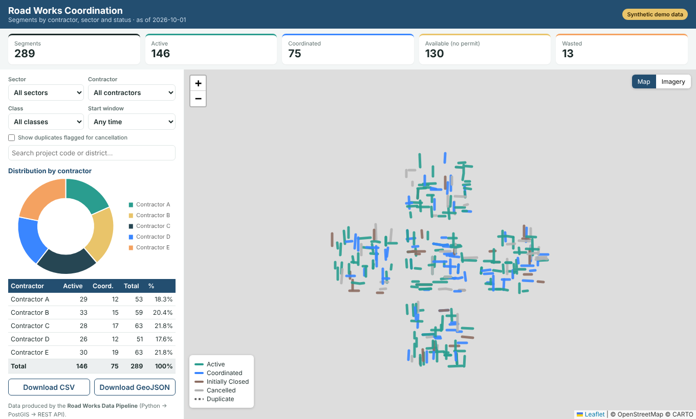

# Road Works Coordination Dashboard

A web GIS dashboard for coordinating road works across a city: which segments are **active**, **coordinated** or **closed**, which **contractor** and **sector** they belong to, and which works are starting in the next 30 days.

> ⚠️ **Synthetic demo data.** All projects, contractors, sectors and districts are fictional, generated by the companion repo `road-works-pipeline`. It mirrors the kind of tool I build professionally, without exposing any client data.

> 💼 **About my production work.** This repo is a public sample. My real production dashboards for Riyadh Municipality run on Netlify behind password protection, because they belong to my employer. I can demonstrate them live during an interview.

**Live demo:** _add your Netlify link here_



## Features
- Road segments on an interactive map, coloured by status, with detailed pop-ups
- Filters: sector, contractor, class (Utilized / Available / Wasted), start window (active + next 7/30 days), free-text search
- Duplicates flagged by the pipeline can be shown as dashed lines
- KPI cards, contractor distribution doughnut and summary table (click a row to filter)
- Light map / satellite imagery switch
- Export of the filtered view as **CSV** or **GeoJSON**
- Optional site-wide **password gate** via a Netlify Edge Function
- Responsive layout; no build step, libraries vendored for reliability

## How it fits together
```
road-works-pipeline  ──►  segments.geojson / REST API (PostGIS)  ──►  this dashboard
 (Python rules, QA)                                                    (Leaflet + Chart.js)
```
The dashboard reads `web/data/segments.geojson`. To read live data instead, point `DATA_URL` in `web/app.js` at the pipeline's API, e.g. `https://<api-host>/segments?include_duplicates=true`.

## Run locally
```bash
cd web && python -m http.server 8000     # open http://localhost:8000
```

## Deploy to Netlify
1. Push this repo to GitHub.
2. Netlify → **Add new project → Import from GitHub** → select the repo (settings come from `netlify.toml`).
3. *(Optional)* Add an environment variable `SITE_PASSWORD` to require a password.

## Tech
Leaflet 1.9 · Chart.js 4 · vanilla JavaScript · Netlify (static hosting + Edge Functions)

## Author
**Amna Abdein** — GIS Engineer & Geospatial Web Developer
